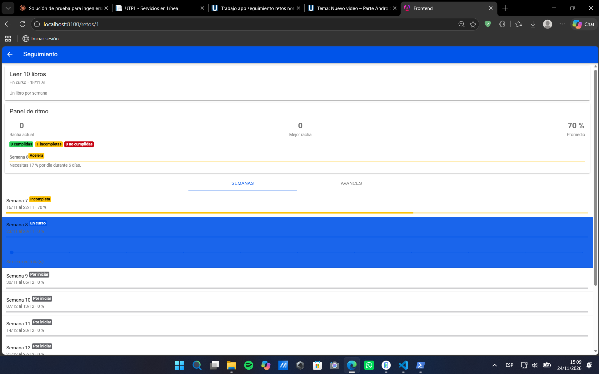
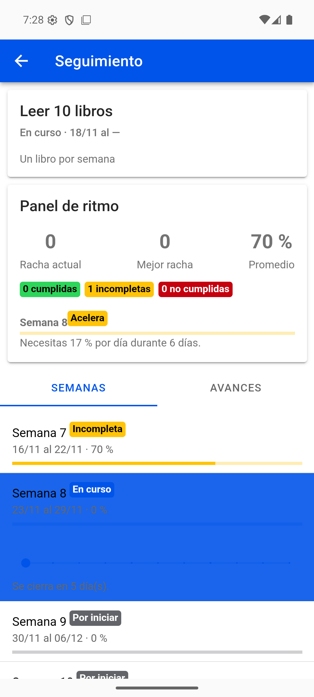

# Seguimiento de Retos

Aplicación de seguimiento semanal de retos. Backend Django REST + MySQL, frontend Ionic/Angular y app Android con Capacitor (un solo código para web y Android).

- Guías base: instalación, backend paso a paso y frontend paso a paso (semanas 7 a 15 con semáforo y alertas).
- Evidencias de la entrega: [docs/EVIDENCIAS.md](docs/EVIDENCIAS.md).

## Funcionalidad propia: Panel de ritmo y racha

### Propósito

El semáforo de la guía solo dice **cómo quedó** una semana cuando ya cerró. Esta función responde a la pregunta que importa mientras la semana sigue abierta: **¿cuánto debo avanzar hoy para no cerrar en rojo?**

Para cada reto muestra:

| Dato | Qué significa |
| --- | --- |
| Racha actual | Semanas cumplidas (100 %) seguidas, contando hacia atrás desde la última semana cerrada |
| Mejor racha | La racha más larga que ha tenido el reto |
| Promedio | Cumplimiento promedio de las semanas ya cerradas |
| Cumplidas / incompletas / no cumplidas | Cuántas semanas cerradas hay de cada color |
| Ritmo diario | Porcentaje que hay que avanzar cada día, contando hoy, para llegar al 100 % antes del cierre |

El ritmo se clasifica con una etiqueta de color: **Cumplida** (verde), **Buen ritmo** (hasta 15 % por día, azul), **Acelera** (hasta 30 %, amarillo) y **Urgente** (más de 30 %, rojo).

### Cómo funciona

1. El frontend pide `GET /api/retos/{id}/estadisticas/`.
2. El backend lee las tareas semanales del reto y calcula todo en `calcular_estadisticas` (función pura, sin acceso a la API).
3. El panel se actualiza solo: está enlazado al flujo `semanas$`, que emite al guardar un porcentaje, al recargar o al cambiar el día (flujo reactivo propio **F8**, además de F1 a F7 de la guía).

Ejemplo de respuesta:

```json
{
  "semanas_total": 9, "cerradas": 1, "verdes": 0, "amarillas": 1, "rojas": 0,
  "cumplimiento_promedio": 70.0, "racha_actual": 0, "mejor_racha": 0,
  "semana_actual": {
    "semana": 8, "porcentaje": 0, "faltante": 100,
    "dias_restantes": 6, "ritmo_diario": 17
  }
}
```

### Archivos

**Backend**

| Archivo | Cambio |
| --- | --- |
| `backend/retos/estadisticas.py` | Nuevo. Cálculo de colores, rachas, promedio y ritmo diario |
| `backend/retos/views.py` | Acción `estadisticas` en `RetoViewSet` |
| `backend/retos/test_estadisticas.py` | Nuevo. 7 pruebas (5 de cálculo y 2 de API) |

**Frontend**

| Archivo | Cambio |
| --- | --- |
| `frontend/src/app/core/ritmo.ts` | Nuevo. Nivel y mensaje del ritmo (funciones puras) |
| `frontend/src/app/core/ritmo.spec.ts` | Nuevo. 7 pruebas unitarias |
| `frontend/src/app/core/modelos.ts` | Interfaces `EstadisticasReto` y `SemanaEnCurso` |
| `frontend/src/app/core/retos-api.service.ts` | Método `obtenerEstadisticas` |
| `frontend/src/app/paginas/panel-ritmo.component.ts` | Nuevo. Componente del panel |
| `frontend/src/app/paginas/reto-detalle.page.ts` | Inserta el panel y el flujo `estadisticas$` |

### Captura en la web



### Captura en Android



## Ejecutar

```powershell
# Backend (desde backend, con .venv activo)
python manage.py test retos
python manage.py runserver 0.0.0.0:8000

# Frontend (desde frontend)
npx.cmd ng test --watch=false
npm.cmd run build
npx.cmd cap sync android
```
