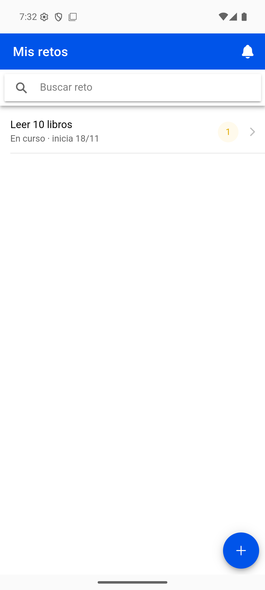
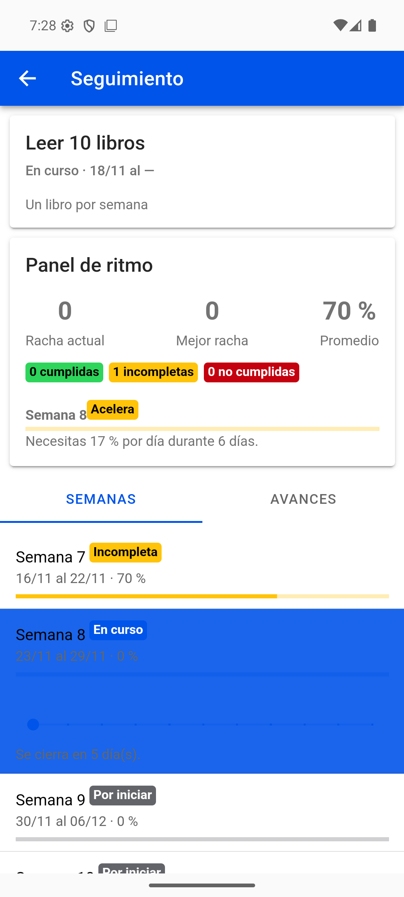
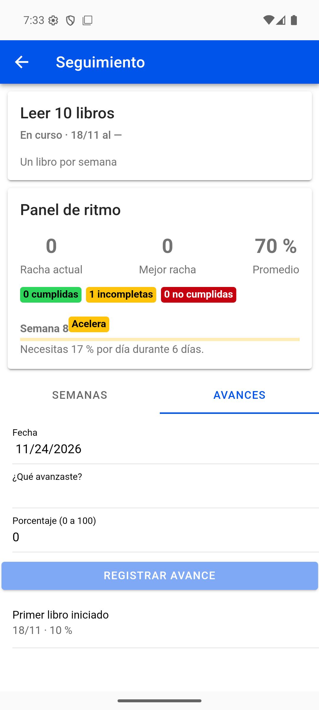
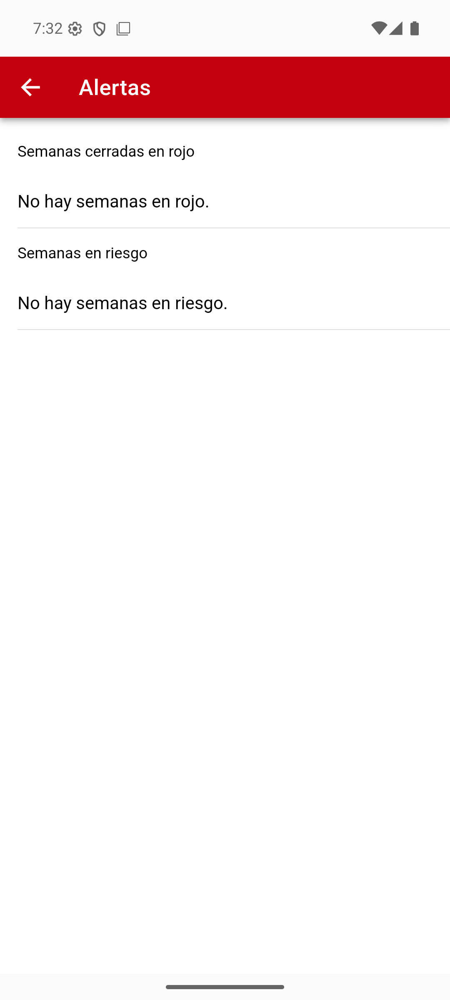

# Evidencias de la entrega

Estudiante: _(nombre)_ · Repositorio: https://github.com/jhordycamacas/seguimiento_retos

> Las capturas se toman en pantalla completa desde Visual Studio Code, con la terminal integrada abierta y el comando ejecutado en ella. En cada evidencia se indica el comando y el resultado esperado. Los resultados de texto de abajo se obtuvieron el 24/11/2026.

## Evidencia 1: instalación y backend

Terminal de VS Code, en `backend` con `(.venv)` activo:

```powershell
Get-Service MySQL84
python manage.py check --database default
python manage.py showmigrations retos
python manage.py test retos
```

Resultado obtenido:

```text
Status: Running (inicio Automatic)
System check identified no issues (0 silenced).
retos
 [X] 0001_initial
 [X] 0002_tareasemanal
Ran 12 tests ... OK      (5 de la guía + 7 de la funcionalidad propia)
```

Con el servidor iniciado (`python manage.py runserver 0.0.0.0:8000`), abrir en el navegador `http://127.0.0.1:8000/api/tareas/`.

**Captura 1:** VS Code a pantalla completa con la terminal mostrando `Ran 12 tests ... OK`.
**Captura 1b:** navegador con `/api/tareas/`.

## Evidencia 2: build y pruebas del frontend

Terminal de VS Code, en `frontend`:

```powershell
npm.cmd run build
npx.cmd ng test --watch=false
```

Resultado obtenido: `Application bundle generation complete` (solo un aviso de tamaño de bundle, no es un error) y `Tests 15 passed (15)`.

**Captura 2:** VS Code con ambos comandos terminados sin errores.

## Evidencia 3: aplicación web

Terminal de VS Code, en `frontend`: `ionic.cmd serve --port=8100` y abrir `http://localhost:8100`. Mostrar: lista de retos con semáforo, detalle con semanas 7 a 15, una semana guardada con el control de porcentaje, un avance registrado y el panel de ritmo.

**Captura 3:** VS Code con la terminal del servidor y el navegador con el detalle del reto.

## Evidencia 4: aplicación Android

Terminal de VS Code, en `frontend`:

```powershell
npm.cmd run build
npx.cmd cap sync android
Set-Location android
.\gradlew.bat assembleDebug
```

Con `runserver 0.0.0.0:8000` activo, abrir la app **Seguimiento de Retos** en el emulador y mostrar el detalle de un reto con sus semanas.

**Captura 4:** VS Code (terminal con `BUILD SUCCESSFUL`) junto al emulador con la app cargando datos de `10.0.2.2:8000`.

Capturas del emulador (Pixel 7, API 36), obtenidas con `adb` el 24/11/2026:

| Lista de retos | Detalle con panel de ritmo | Avances | Alertas |
| --- | --- | --- | --- |
|  |  |  |  |

## Evidencia 5: cierre de semana, alerta en rojo y respuesta 400

Respuesta 400 al modificar una semana cerrada (obtenida):

```text
PATCH /api/tareas/{id}/   {"porcentaje": 100}   (semana 7, ya cerrada)
{"non_field_errors":["La semana 7 ya está cerrada; no se puede modificar."]}
HTTP 400
```

Para la alerta roja, seguir el apartado 11 de la guía 04: en el administrador de Django (`/admin/`) dejar una semana ya cerrada con menos de 10 %, abrir la app y comprobar el aviso en rojo y la página de alertas.

**Captura 5a:** terminal de VS Code con el PATCH y su `400`.
**Captura 5b:** aviso en rojo y página de alertas en la app.

## Evidencia de la funcionalidad propia: Panel de ritmo y racha

Descripción completa, archivos modificados y propósito: [README.md](../README.md).

Terminal de VS Code, con el servidor activo:

```powershell
Invoke-RestMethod http://127.0.0.1:8000/api/retos/1/estadisticas/
python manage.py test retos.test_estadisticas -v 2
```

Resultado obtenido de la API:

```json
{"semanas_total":9,"cerradas":1,"verdes":0,"amarillas":1,"rojas":0,
 "cumplimiento_promedio":70.0,"racha_actual":0,"mejor_racha":0,
 "semana_actual":{"semana":8,"porcentaje":0,"faltante":100,"dias_restantes":6,"ritmo_diario":17}}
```

Funcionando en Android (emulador): 

**Captura 6:** VS Code con la terminal mostrando el endpoint y las 7 pruebas nuevas en OK.
**Captura 7:** la web en `http://localhost:8100` con el panel de ritmo.
**Captura 8:** el emulador con el panel de ritmo.
